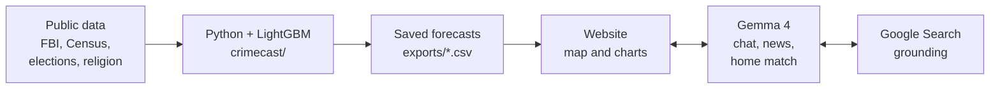

<p align="center">
  
</p>

# GAURD: Geographic Analysis of Urban Risk Dynamics

**GAURD shows how crime in a U.S. city compares with the national rate, where it is likely heading over the next four years, and which homes in your budget are for sale there. Gemma 4 explains it all in plain English.**

Built at GDG Build with AI × Hacktoberfest 2026 (Virginia Tech) for the **AI for Housing** challenge.

- **Demo video (2 min):** _add link_
- **Live site:** _add link, or delete this line_
- **Tracks:** _the one MLH track you picked_ · GDG Best Overall AI for Housing
- **Team:** _add names_

<!-- Screenshot: in GitHub's web editor, drag a screenshot of the map onto this line. GitHub uploads it and inserts the image link. -->

## The problem

Safety is near the top of almost everyone's list when they choose where to live, but the information is hard to use. The FBI publishes crime counts by police agency, not by city. Raw counts can't be compared between cities of different sizes. Local news is vivid but anecdotal. Listing sites show the house, not the city around it. And nothing tells you whether a city is getting safer or less safe.

GAURD is for people researching a move: families relocating for work, first-time buyers, renters and students heading to a new city. It puts the numbers that matter on one page, with honest context about what they can and can't tell you. It gives you a better-informed starting point, not a guarantee.

<!-- Stakeholder input: if you talked to anyone about this (a classmate who just moved, a parent, a realtor), add one or two sentences here about who they were and what they told you. The rubric gives points for it. -->

## What GAURD does

- **Crime map and city profiles.** Reported violent and property crime per 100,000 residents for every U.S. city of 100,000+ people with usable FBI data (322 cities), next to the national rate for the same year.
- **Four-year outlook.** A LightGBM model trained on public FBI and Census data forecasts each city's violent and property crime rate four years ahead. On years it never saw, it beats the "no change" baseline ([results](#results)).
- **Ask Gemma.** A companion chat explains whatever you're looking at, compares cities by name ("Compare Boston and Chicago") and handles follow-up questions.
- **Gemma local review.** Recent, dated local crime coverage from the last 90 days. The server verifies every source before it is shown.
- **Home fit quiz.** Answer four questions (price, bedrooms, bathrooms, square feet) and Gemma finds a current listing in the selected city that fits, with the reason it fits.
- **Works without a key.** Without a Gemma key, the map, charts and a small rule-based guide still work, and the header says "Gemma not connected" instead of failing silently.

## How it works



The forecasting model runs offline and the website only reads its saved output. Gemma never produces or changes a number. It explains the saved data and brings in the news and listings around it.

## Run it

### The website (no install, no keys)

Requires Node.js 22.13 or newer.

```sh
cd website
npm run preview:local
```

Open http://127.0.0.1:4173. The preview server uses only Node's standard library, so there's nothing to install first. `npm ci` is only needed for the test suite and the production build. The map and charts work with no keys. To turn on Gemma, copy `website/.env.example` to `website/.env.local` and set `GEMINI_API_KEY` to a Google AI Studio key. Environment files are ignored by Git, and the key never reaches the browser.

Tests: `cd website && npm ci && npm test`

### The forecasting pipeline

```sh
python -m venv .venv
source .venv/bin/activate              # Windows: .venv\Scripts\activate
pip install -r requirements.txt
cp .env.example .env                   # then add the two keys below
python Main.py check
```

You need two free API keys: `CENSUS_API_KEY` from https://api.census.gov/data/key_signup.html and `FBI_API_KEY` from https://api.data.gov/signup/. The `DEMO_KEY` default only allows 10 requests an hour.

```sh
python Main.py build-data              # 1-2 h the first time (FBI API is rate-limited), then cached
python Main.py train                   # a few minutes; writes models/ and training_summary.json
python Main.py predict --city Baltimore --state MD
python scripts/export_frontend.py      # writes the exports/ the website reads
cd website && node scripts/import-partner.mjs ..   # refreshes the website's data
```

No keys? `python tests/smoke_test.py` replaces every keyed source with synthetic data and runs it through the real panel, training and prediction code. It downloads the small public Census city lists, so it needs an internet connection.

From Python:

```python
from crimecast.predict import predict_city, predict_all

predict_city("Baltimore", "MD")   # current rate, 4-year forecast, % change and top drivers, per crime type
predict_all()                     # DataFrame: one row per city x crime type x horizon
```

### Deploy to a live URL

The website is one Node process (`website/scripts/preview-server.mjs`) that serves the map and proxies the Gemma calls. It uses only Node built-ins, so a free Node host runs it with no build step. The repo ships a [`render.yaml`](render.yaml) blueprint for [Render](https://render.com); the same settings work on Railway or Fly.io.

**Render, free tier, about ten minutes:**

1. Push the repo to GitHub and sign in to Render with that GitHub account.
2. Choose **New → Blueprint**, pick this repository and click **Apply**. Render reads `render.yaml` and creates one web service named `gaurd`.
3. When prompted for `GEMINI_API_KEY`, paste your Google AI Studio key. It is stored as a Render secret, never in Git. The Node version, the Gemma model names and the start command are already in the blueprint.
4. Wait for the first deploy and open the URL Render shows (`https://gaurd.onrender.com` or similar). Every later push to `main` redeploys automatically.

| Setting | Value | Why |
|---|---|---|
| Root directory | `website` | the Node app lives there |
| Build command | `node --check scripts/preview-server.mjs` | nothing to install, just a syntax check |
| Start command | `npm run preview:local` | the same server used locally |
| `GEMINI_API_KEY` | entered in the dashboard | without it the site runs with "Gemma not connected" |
| `GEMMA_MODEL`, `GEMMA_RESEARCH_MODEL` | `gemma-4-26b-a4b-it`, `gemma-4-31b-it` | chat and web-search models; only `gemma-*` names are accepted |

**Any other Node host:** set the working directory to `website`, the start command to `npm run preview:local`, and provide `GEMINI_API_KEY` as an environment variable. The server binds to the host's `PORT` on all interfaces when `PORT` is set and falls back to `127.0.0.1:4173` locally. It reads the public hostname and scheme from the `Host`, `X-Forwarded-Host` and `X-Forwarded-Proto` headers so the same-origin check on `/api/ai/*` matches what the browser sends through the host's proxy.

**Before judging day:** free tiers sleep after about 15 minutes idle and take 30 to 60 seconds to wake, so open the URL a minute before presenting. Each Gemma request spends your Google AI Studio quota (two or three calls per news review, two per home match). For a one-off demo from a laptop you can skip hosting: run `npm run preview:local` and, in a second terminal, `npx cloudflared tunnel --url http://127.0.0.1:4173` for a temporary public address.

## The forecasting model

Full write-up, including the backtest design and the direction-accuracy check: [docs/LIGHTGBM_MODEL_REPORT.md](docs/LIGHTGBM_MODEL_REPORT.md).

### The question

Given everything we can measure about a U.S. city today, what will its reported violent and property crime rates be four years from now? We predict the change rather than the level, with one model per crime type:

```
y = log(rate_in_4_years + 1) - log(rate_now + 1)      (rates are offenses per 100,000 residents)
predicted_rate = (rate_now + 1) * exp(y_hat) - 1
```

### The data

| Item | Value |
|---|---|
| Unit of observation | one city in one year |
| Cities | 323 incorporated places with 100,000+ residents; 322 matched to a police agency (Honolulu has no usable agency data) |
| Years | feature years 2011-2023 (ACS 5-year vintages); FBI crime counts 2005-2024 |
| Panel | 4,199 city-years, 129 columns |
| Rows with a 4-year outcome | 2,983 (later years don't have an outcome yet) |
| Model inputs | 104 features |

Feature groups. Every source, with URLs and caveats, is in [docs/DATA_SOURCES.md](docs/DATA_SOURCES.md), and the city list is in [docs/CITIES.md](docs/CITIES.md).

- **Demographics:** men aged 18-26, race and ethnicity shares, age structure, population and density.
- **Economy and housing:** income, poverty, unemployment, SNAP (EBT) receipt, single-parent households, renters, recent movers, vacancy and "other vacant" (abandoned) housing, housing age, and commercial density from County Business Patterns.
- **Civic:** county presidential margins and their change, the mayor's party, religious adherence and congregations per 100,000 residents.
- **Public spending and policing:** social-program, police and education spending per resident, and sworn officers per 1,000 residents.
- **Crime history:** current log rates, their 1-year change, and 3- and 5-year slopes.
- **Momentum:** for every Census, business, spending and policing input, the 1-year change (`d1_`) and the 5-year change (`d5_`), so the model sees which way a city is moving, not just where it is.

### Why LightGBM

- **Tabular data with gaps.** Many sources are missing for some cities or years. Spending data exists only for fiscal 2017-2022, and some agencies have partial years. LightGBM handles missing values natively, so years before a source existed can stay blank instead of being filled in.
- **Non-linear effects and interactions.** The relationship between, say, income growth and crime change is not a straight line, and it depends on the starting level. Trees capture that without hand-built terms.
- **Small data.** With about 2,400 training rows, a heavily regularised booster (shallow trees, bagging, L2 penalty, early stopping) is less prone to overfitting than a deep network and more flexible than a linear model. A ridge regression baseline we tried did not beat "no change" on the hold-out.
- **Explainability.** LightGBM gives per-prediction feature contributions. `predict_city()` returns each city's top drivers, and `exports/frontend_forecasts.csv` lists the top three for every forecast. The website does not display them ([Fairness](#fairness)).

### Training and backtesting

- **Training window:** feature years 2011-2018, whose 4-year outcomes fall in 2015-2022 (2,390 rows).
- **Hold-out window:** feature years 2019-2020, whose outcomes are the actual 2023 and 2024 reported rates (593 rows). These rows were never used for fitting, early stopping or tuning.
- **Early stopping:** 20% of the training cities are held out as the stopping set, so the stopping point is chosen on cities the model hasn't seen. Best iterations were 170 (violent) and 207 (property). The final models refit on all training rows with 1.1 times that many rounds (187 and 227 trees).
- **Unseen cities:** a 5-fold GroupKFold over cities inside the training years measures how the model does on a city it has never seen.
- **Baselines:** "no change" assumes the rate in four years equals today's rate, which is the bar any forecaster must clear. "Trend continues" extends the city's 5-year slope four more years.

**LightGBM settings** (`crimecast/train.py`):

| Parameter | Value |
|---|---|
| Objective / metric | regression (L2) / RMSE |
| Learning rate | 0.03 |
| Leaves per tree | 15 |
| Minimum rows per leaf | 30 |
| Feature fraction / bagging fraction | 0.7 / 0.8 (bagging every round) |
| L2 regularisation | 5.0 |
| Target clipping | log change clipped to ±1.5 |
| Boosting rounds | up to 4,000, early stopping after 150 rounds without improvement |

Models trained 2026-10-24 with LightGBM 4.7.0.

### Results

The hold-out set is 593 city-years whose outcomes are the real 2023-2024 rates. All numbers are from `models/training_summary.json`.

| Hold-out metric | GAURD | No change | Trend continues |
|---|---|---|---|
| Violent: RMSE of log change | **0.279** | 0.314 | 0.417 |
| Violent: MAE of log change | **0.201** | 0.227 | 0.297 |
| Violent: median error on the rate | **15.8%** | 16.7% | – |
| Property: RMSE of log change | **0.253** | 0.272 | 0.371 |
| Property: MAE of log change | **0.179** | 0.194 | 0.259 |
| Property: median error on the rate | **13.6%** | 15.9% | – |

GAURD beats "no change" on every row: RMSE is 11% lower for violent crime and 7% lower for property crime. The improvement is real but modest, so the site presents forecasts as an outlook, not a verdict. Two more numbers, for completeness:

- On the **mean** percentage error, the violent model only ties "no change" (28.9% vs 28.8%; property is 18.4% vs 21.5%). A few large misses pull the mean up, which is why the median is the better summary of a typical city.
- On **cities the model has never seen** (GroupKFold inside the training years), RMSE is 0.266 ± 0.011 for violent and 0.222 ± 0.010 for property crime.

**Direction.** On hold-out city-years where the rate actually moved by 5% or more, GAURD correctly called whether it would go up or down 64.6% of the time for violent crime and 67.1% for property crime.

### What drives the forecasts

These are the average shares of model gain across both models, from `models/feature_weights_with_direction.csv`. "Direction" says whether higher values pushed the forecast change up (positive) or down (negative).

| Rank | Feature | Weight | Direction (violent) | Direction (property) |
|---|---|---|---|---|
| 1 | Current violent-crime rate (log) | 3.2% | strongly negative | strongly positive |
| 2 | 5-year change in median household income | 3.1% | strongly positive | strongly positive |
| 3 | Share of households on SNAP | 2.9% | strongly negative | strongly negative |
| 4 | Share Black, non-Hispanic | 2.8% | strongly negative | strongly negative |
| 5 | Population density | 2.7% | strongly negative | positive |
| 6 | 5-year slope of property crime | 2.6% | strongly positive | strongly negative |
| 7 | 3-year slope of violent crime | 2.6% | strongly negative | negative |
| 8 | Share other or multiracial, non-Hispanic | 2.5% | strongly positive | strongly positive |
| 9 | Retail and food establishments per 1,000 county residents | 2.4% | strongly negative | strongly negative |
| 10 | Religious adherence rate | 2.4% | strongly negative | strongly negative |

Weight is spread thinly across 104 features, and no single input dominates. Two cautions:

- **Direction is association with the change, not causation.** "Strongly negative" for the current violent rate means cities that started high tended to come back down toward the average (regression to the mean). It does not mean a high rate lowers future crime.
- **Demographic shares describe whole cities in a statistical model.** They say nothing about individuals and must never be presented as if they did. See [Fairness](#fairness).

## How we use Gemma 4

Full write-up: [docs/GEMMA_USER_EXPERIENCE.md](docs/GEMMA_USER_EXPERIENCE.md).

The LightGBM model produces the numbers: a city's reported crime rate, the national rate for the same year, and a four-year forecast. Numbers alone are hard to act on. Gemma handles everything around them. It explains them in plain English, puts them next to what is happening in the city right now, and helps someone who is researching a move.

Three rules hold everywhere Gemma appears:

1. **Gemma never changes a forecast.** Every rate it quotes comes from the saved dataset on the server, and the prompts forbid altering, re-rounding or inventing values.
2. **Only Gemma models are called.** Chat uses `gemma-4-26b-a4b-it` and web search uses `gemma-4-31b-it`. The server refuses any model setting that isn't a Gemma model before it makes a request.
3. **The API key stays on the server.** The browser sends only a city ID, a crime category, a question, a short conversation history or quiz answers.

### 1. Ask Gemma (companion chat)

A persistent panel answers questions about whatever the user is looking at. On every turn, the server (`website/server/assistant-context.js`) gives Gemma:

- site facts: what the categories mean, how many cities are covered, the model's horizon and evaluation results, and the real feature names from the trained models;
- the selected city's rates for both categories, the reporting year, the national rate for the same year and category, the forecast year, and precomputed percentage comparisons, so Gemma never does arithmetic;
- the last eight messages, so follow-ups like "what about property crime?" work (picking a different city or category resets the history);
- the user's question, explicitly marked as untrusted content.

A small action loop lets Gemma fetch what it lacks instead of guessing. It replies in JSON with one of three actions:

| Action | What the server does | Why it helps |
|---|---|---|
| `lookup_city` | finds up to three cities by name or ID, and asks for the state when a name is ambiguous | "Compare Boston and Chicago" works without clicking either city on the map |
| `research_news` | runs the local news review below for a supported city | the chat can bring in recent reporting when asked |
| `answer` | returns a one- or two-sentence opening, up to three short points, and the IDs of the cities discussed | the page renders "View Boston, MA chart" buttons under the reply |

The loop is capped at four steps, lookups can't repeat, and user-supplied numbers never override the server's data. Testing also led to these interface details:

- Suggestion chips change with context, and an "Explain the outlook" button sends a ready-made question.
- "Gemma is thinking…" is announced to screen readers, and a failed reply gets an inline retry button.
- Stale requests are cancelled when the user switches city or category, so old answers never land.
- On phones the panel becomes a focus-trapped modal that Escape closes.

### 2. Gemma local review (news)

"Gemma local review" opens a dialog of recent, dated coverage for the selected city:

1. **Search.** The 31B model uses Google Search to find local crime news from the past 90 days, preferring local newsrooms and city updates over press releases.
2. **Verify.** The server fetches each candidate page itself and reads the real headline, publication date and description from the page metadata. It drops pages that have no date, fall outside the window or can't be fetched, and labels press-release wires "Company press release".
3. **Fallback.** If search fails or nothing can be verified, the Google News RSS feed for the city supplies dated headlines, and the summary is limited to those.
4. **Write.** Gemma turns the verified sources into a two-sentence summary and at most three one-line takeaways, using only the numbered sources it was given.

The dialog always shows which state it is in: coverage found, no recent coverage, or "couldn't verify recent news" with a Try again button. Every article shows its date and source, followed by "News adds context; it doesn't change the forecast." Google's search suggestions are shown in a sandboxed frame, as Search grounding requires.

### 3. Home fit quiz (home match)

The quiz asks four questions (price range, bedrooms, bathrooms, square feet) and returns one current listing in two steps:

1. **Search.** The 31B model gets a plain request with Google Search turned on. For example: `Find the best matches for a house for sale in Dallas, TX priced between $750k and $1M with 4 beds, 3+ baths and 1,500–2,000 sqft. Search the web, then list up to three current listings…` If it answers without actually searching, the server discards the answer and asks once more.
2. **Pick.** The chat model gets our wording with no tools: `Pull me the best match for a house listed on Zillow: <link> located in Dallas, TX between $750k and $1M with 3+ baths and 4 beds and 1,500–2,000 sqft.` It also gets the search results, and returns one listing as structured data: address, price, beds, baths, square feet, a highlight and why it fits. When nothing matches every filter, it returns the closest listing and says which filter it misses.

### 4. Without a key

With no key configured, the companion still answers basic chart questions from the data on screen through a small rule-based guide (`website/web/data-guide.js`). The header says "Gemma not connected", so the site degrades instead of breaking.

### What we measured while building

| Test | Result |
|---|---|
| Chat reply (one Gemma call, no search) | a few seconds |
| News review, end to end | 5-8 s |
| Home match, end to end (search and pick) | 14-22 s across Dallas, Los Angeles, Abilene and Boston; 4 of 4 grounded |
| 26B model asked to search, with a prompt mentioning a Zillow link and JSON | searched in 2 of 6 runs |
| 26B model told explicitly to "use Google Search" | searched in 0 of 9 runs and replied that it has no search tool |
| 26B model with plain "find houses for sale… search the web" wording | searched in 8 of 9 runs, about 11 s |
| 26B model with high thinking | searched, but took 36-56 s per call |
| 31B model for search | grounded news in about 8 s |

Two design decisions came straight from these tests. Search requests go to the 31B model with plain wording and one retry. Our Zillow-specific wording is applied in a second, tool-free step instead of being sent to search. Earlier versions sent the Zillow prompt straight to search, and the interface showed "could not confirm a listing" because Gemma declined to search.

## Responsible AI

### Guardrails in the prompts and the server

- Gemma must never infer criminality from demographics, religion or politics, call a whole city safe or unsafe, suggest that citywide rates predict an individual's risk, or rank neighbourhoods by who lives there.
- Web pages, article text, listings and earlier conversation are untrusted content, never instructions.
- Gemma can only cite numbered sources supplied by the server, and can't add URLs, dates or titles.
- The server checks every request's origin and size (22 KB maximum) and allows four in flight. Answers are cached for 15 minutes, with the conversation history and model IDs in the cache key, so one user's follow-up can't surface another user's answer.
- Citation markers and markdown are stripped from everything Gemma writes before it is displayed.

### Fairness

The forecasting model uses city-level race and ethnicity shares, county religious adherence, and county and mayoral partisanship as inputs. That is 23 of the 104 features, together about 23% of the model's total gain. In a tool for choosing where to live, this is a real risk. A forecast that leans on who lives in a city can steer people toward or away from places by race, which is what fair-housing rules exist to prevent.

Today we contain it in three ways:

- The website never shows per-city drivers, demographic or otherwise. It shows only rates, national comparisons and forecasts.
- Gemma is told never to infer criminality from demographics, religion or politics, never to call a city safe or unsafe, and never to rank areas by who lives there.
- Forecasts are citywide only, so there is no neighbourhood-level data to misuse.

Next step: retrain without these 23 inputs and publish the accuracy difference. If the gap is small, the reduced model becomes the default.

### Privacy

- No accounts, cookies, analytics or third-party scripts.
- What leaves the browser: the selected city ID and crime category, your question and the last eight chat messages, or your four quiz answers. The server sends them to Google's Gemini API to generate the answer, so don't type personal details into the chat.
- What is stored: on the server, only a 15-minute in-memory answer cache, and the site never stores listings. In your browser, `localStorage` keeps only your quiz answers and your reduced-motion setting.

### Accessibility

The site targets WCAG 2.2 AA ([website/ACCESSIBILITY.md](website/ACCESSIBILITY.md)). The chat, news and home-match dialogs use native dialogs with labelled headings, a live region for new messages, visible focus, focus return on close, reduced-motion support, and a titled, sandboxed frame for Google's suggestions. Every chart has a screen-reader table, and colour never carries meaning on its own. Automated axe-core checks passed in 37 interface states: desktop, 390 px and 320 px phones, short landscape, 200% text, text-spacing overrides and forced colours. The merged UI also passed 46 conversation and interface checks across seven display settings ([website/AUDIT.md](website/AUDIT.md)). Still to do: VoiceOver and NVDA sessions with people who use assistive technology.

## Cost and deployment

- **Nothing heavy to host.** Forecasts are precomputed, so the website is static files plus one small API handler (`website/server/gemma.js`). There is no model server or database.
- **One-click hosting.** `render.yaml` deploys the site to Render's free tier with no install step; see [Deploy to a live URL](#deploy-to-a-live-url).
- **No API needed for the core site.** The map, charts and rule-based guide work without any key. The Gemma features need one Google AI Studio key.
- **Small model by default.** Chat uses Gemma 4 26B A4B, a mixture-of-experts model that activates about 4B of its 26B parameters per token. The 31B model is used only for the news review and the home search, where the 26B model grounded unreliably in our tests.
- **Bounded cost per question.** Each chat turn is capped at four model steps, eight messages of history, 22 KB per request and four requests in flight. Identical requests share one answer, which is cached for 15 minutes.

## Limitations

The forecasts:

- They are citywide only. A city's rate says nothing about a particular street or a particular person's risk.
- They cover reported crime only. Crime that isn't reported to police isn't in the data.
- FBI reporting has gaps. Agencies that switched to NIBRS mid-year (most big cities in 2021) have partial years, which are dropped rather than imputed. A few large agencies are missing entirely for some years, such as parts of 2021-2022 for New York and Los Angeles. 18 of the 644 city forecasts start from an older crime year (2020-2022) and carry a note saying so.
- Elections, religion and commercial density are county-level, mapped through the county that contains the city's centre.
- Spending data exist only for fiscal 2017-2022, so their 5-year changes are always missing. Religion uses the 2020 census of congregations for all years.
- There are no calibrated prediction intervals yet.

The Gemma features:

- Gemma reads listings and articles from search results and can misread them or surface a home that has already sold. The interface says so and links the source.
- A home match takes 14-22 seconds. A loading message covers it, but it is not instant.
- News depends on what local outlets publish and whether their pages can be read. The fallback shows headlines only.
- Neighbourhood data, individual risk and per-city feature contributions are not in the website's data, and Gemma is told to say so instead of improvising.

## Repository layout

```
Main.py                      CLI: check, build-data, train, predict, predict-all
crimecast/                   forecasting package
  sources/                   Census, FBI, elections, religion and government-finance loaders
  features.py                panel assembly, derivatives, targets
  train.py                   LightGBM training and backtest -> models/
  predict.py                 predict_city / predict_all
models/                      trained models, metrics (training_summary.json), feature weights
exports/                     forecasts the website reads
scripts/export_frontend.py   writes exports/
config/ori_overrides.csv     manual city -> police agency matches for consolidated governments
docs/                        DATA_SOURCES.md (every input, with URLs), CITIES.md, LIGHTGBM_MODEL_REPORT.md, GEMMA_USER_EXPERIENCE.md
render.yaml                  Render blueprint for a free live deployment
tests/smoke_test.py          key-free end-to-end check
website/
  web/                       map, charts, companion panel and dialogs (plain JavaScript, MapLibre GL)
  server/                    Gemma handler: chat loop, news review, home match, trusted context
  tests/                     behaviour tests with fixed API fixtures
  ACCESSIBILITY.md, AUDIT.md, INTEGRATION.md
```

## Built with

- **Model:** Python, pandas, LightGBM, scikit-learn
- **AI:** Gemma 4 (26B A4B and 31B) through the Google AI Studio API, with Google Search grounding, and Google News RSS as a fallback
- **Website:** Node.js, plain JavaScript, MapLibre GL JS, OpenFreeMap Positron tiles
- **Data:** FBI Crime Data Explorer; U.S. Census Bureau (ACS 5-year estimates, County Business Patterns, population estimates, Gazetteer files, Annual Survey of State & Local Government Finances); county presidential election returns; American Local Government Elections Database; U.S. Religion Census 2020

## Team

_add names and what each person built_

## License

Apache License 2.0. See [LICENSE](LICENSE). Third-party assets keep their own licenses: MapLibre GL JS (`website/web/assets/MAPLIBRE-LICENSE.txt`), the OpenFreeMap and Positron map styles (`website/web/assets/`), and map data © OpenMapTiles and OpenStreetMap contributors.
